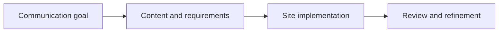

# DeanHStanton.com

**Project type:** Professional website and digital publishing | **Role:** Site owner, product direction, content, and implementation review

## Overview

[DeanHStanton.com](https://deanhstanton.com) presents my professional experience, writing, and work across operations, engineering, project management, and AI.

## My contribution

- Define the site's purpose, information structure, and presentation priorities.
- Develop and review professional content.
- Specify improvements to site functionality and visitor experience.
- Evaluate implementations against usability and business objectives.

## Representative project workflow

*Illustrative workflow only.*

## What this demonstrates

Product ownership, business-to-technical requirements translation, content strategy, user experience review, and iterative delivery.

## What is public

The public website is available at [deanhstanton.com](https://deanhstanton.com). The software repository and internal configuration remain private.

[Back to portfolio](../../README.md)
