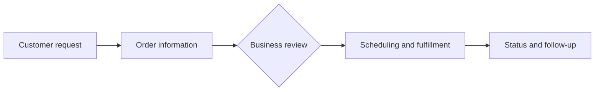

# Dumpster SaaS Platform

**Project type:** Business software product | **Role:** Product direction, business requirements, workflow design, and acceptance review

## Overview

This project applies software to the practical workflow of a dumpster rental operation. The focus is connecting customer interactions, order handling, internal decisions, and fulfillment into a coherent business process.

## My contribution

- Define operational needs and translate them into software requirements and acceptance criteria.
- Review workflows from both the customer and business-operator perspectives.
- Evaluate product behavior, edge cases, and the usability of proposed changes.
- Coordinate implementation priorities and assess whether delivered functionality meets the intended business outcome.

## Representative workflow

*This is a simplified business-process illustration, not an internal system architecture or a claim that every depicted step is implemented.*

## Engineering and product considerations

The work requires attention to clear business rules, order states, operational exceptions, role-based decisions, auditability, and testable requirements. A feature is useful only when it fits the workflow and can be reliably operated.

## What is public

This is a sanitized project overview. Application source code, configuration, customer records, and implementation details remain private.

[Back to portfolio](../../README.md)
