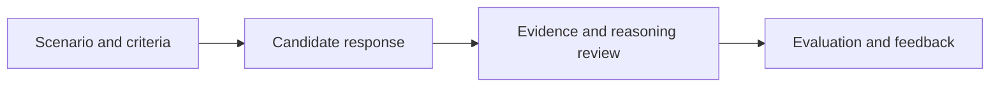

# Project Management Judgment Lab

**Project type:** Domain-specific reasoning and evaluation | **Role:** Subject-matter direction and evaluation design

## Overview

Project Management Judgment Lab explores how to assess the quality of project-management reasoning using realistic scenarios, clear requirements, and professional judgment.

The emphasis is on whether an answer is supported, practical, consistent with the scenario, and useful to the person making a project decision.

## Areas of focus

- Requirements and rubric interpretation.
- Distinguishing material errors from minor formatting or wording differences.
- Evidence-based evaluation of project-management outputs.
- Consistency, proportionality, and traceable judgments.

## Representative evaluation workflow

*This is a conceptual evaluation workflow, not proprietary evaluation code or an assertion about a deployed system.*

## What this demonstrates

My project-management teaching and leadership experience applied to quality assessment of AI-supported reasoning and operational decisions.

## What is public

This overview intentionally excludes private examples, assessment materials, and implementation details.

[Back to portfolio](../../README.md)
