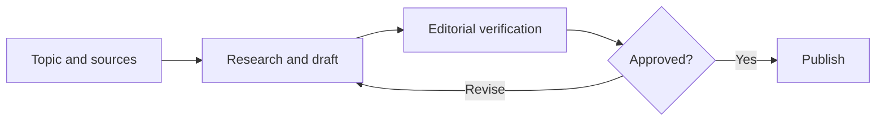

# StantonPress

**Project type:** Digital publishing and AI workflow | **Role:** Product owner, editorial direction, requirements, and acceptance review

## Overview

[StantonPress](https://stantonpress.com) is a publishing initiative focused on useful business and technology briefings. The project explores how AI-assisted research and drafting can support an editorial workflow while maintaining human review, accuracy, and publication control.

## My contribution

- Set the publication's editorial purpose and reader experience.
- Define requirements for briefing structure, website presentation, and publishing operations.
- Review generated content and outputs for practical value and accuracy.
- Evaluate changes to publishing, distribution, and user-facing workflows.

## Representative editorial workflow

*This diagram illustrates the editorial approach and is not a disclosure of the production architecture or a guarantee of automated behavior.*

## What this demonstrates

A combination of requirements management, AI output evaluation, practical workflow design, publishing judgment, and attention to the difference between generating content and approving it for release.

## What is public

This is a high-level project description. Private source code, credentials, publishing integrations, and internal process details are excluded.

[Back to portfolio](../../README.md)
